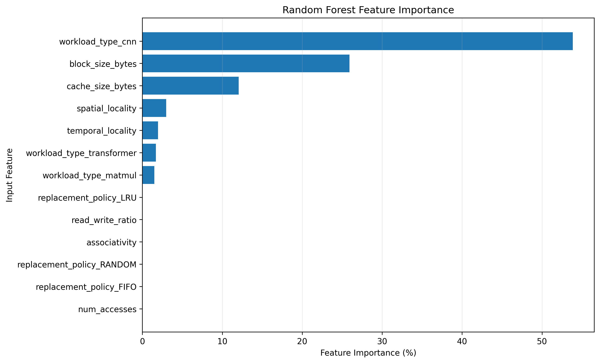
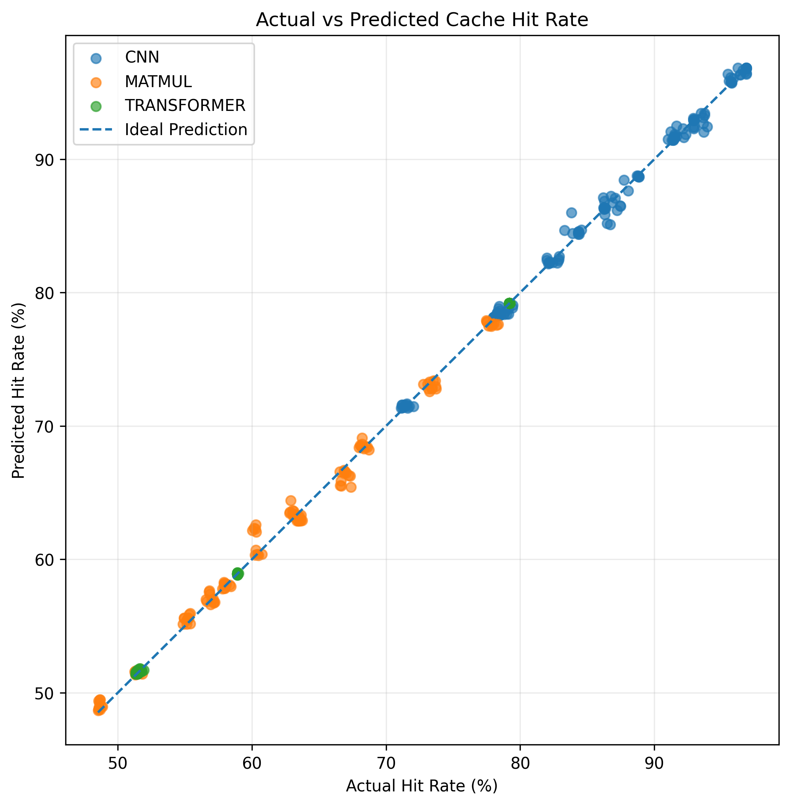
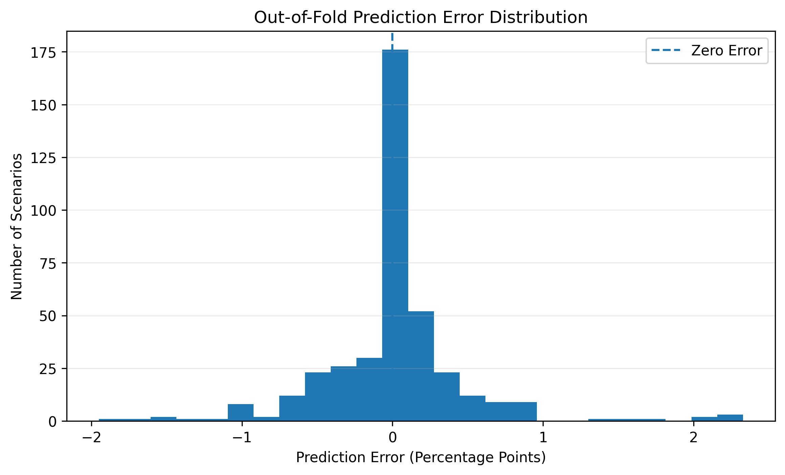
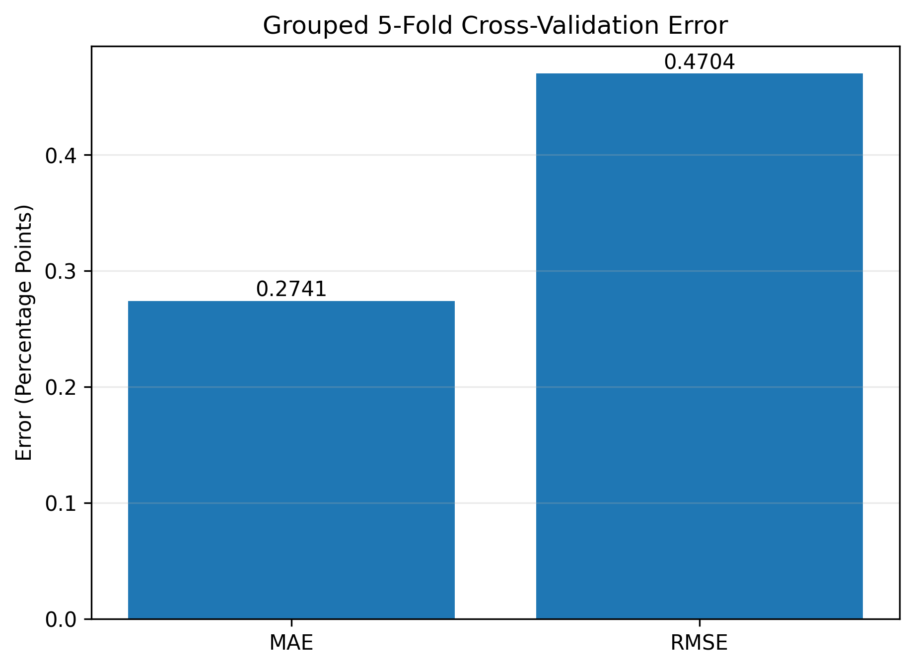
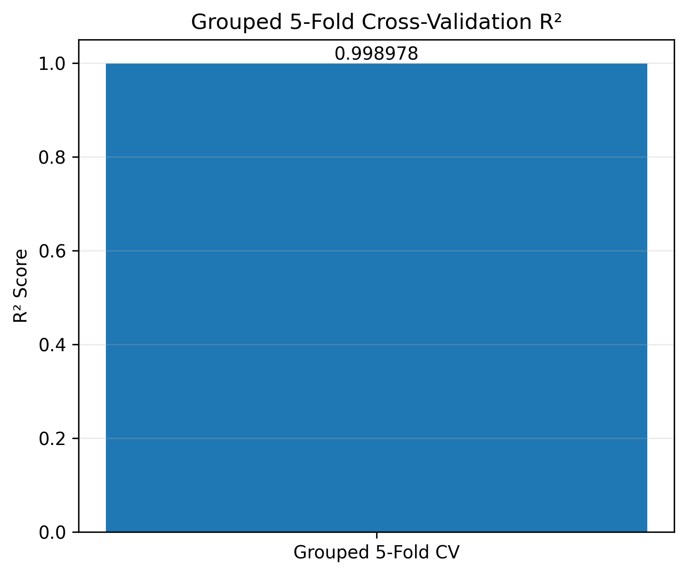
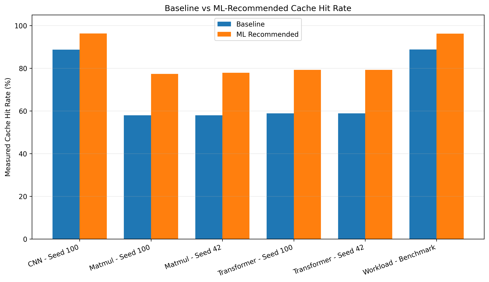

# Machine Learning Results & Visualizations

This directory contains the visualizations and evaluation results of the **Workload-Aware Cache Optimization Engine for AI Inference**.

The project uses a Random Forest regression model to predict cache hit rates for different workload and cache configurations. The model helps identify cache configurations that can improve cache performance.

All visualizations below are generated using the existing training results, grouped cross-validation predictions, and validated Vivado XSim benchmark measurements.

---

## 1. Random Forest Feature Importance

Shows the relative contribution of each input feature to the Random Forest model's predictions.

## 2. Actual vs Predicted Cache Hit Rate

Compares actual cache hit rates against the model's out-of-fold predictions across 396 scenarios.

Points closer to the diagonal represent more accurate predictions.

## 3. Prediction Error Distribution

Shows the distribution of prediction errors across the grouped cross-validation out-of-fold predictions.

## 4. Cross-Validation Error Metrics

Displays the Mean Absolute Error (MAE) and Root Mean Squared Error (RMSE) obtained through grouped five-fold cross-validation.

- MAE: 0.0027415
- RMSE: 0.0047041

## 5. Cross-Validation R² Score

Shows the pooled R² score obtained through grouped five-fold cross-validation.

- R² Score: 0.9989783

## 6. Baseline vs ML-Recommended Cache Hit Rate

Compares the measured cache hit rates of the baseline cache configuration against the ML-recommended configurations across six benchmark experiments.

All measurements are based on Vivado XSim behavioral simulations with 10,000 memory accesses per experiment.

---

## Model Evaluation Summary

| Metric | Result |
|---|---:|
| Dataset scenarios | 396 |
| Distinct workload traces | 15 |
| Cross-validation | Grouped 5-Fold |
| Pooled MAE | 0.0027415 |
| Pooled RMSE | 0.0047041 |
| Pooled R² | 0.9989783 |

## Benchmark Summary

The ML-recommended cache configurations improved the measured hit rate in all six tested baseline comparisons.

| Workload | Seed | Baseline Hit Rate | ML Hit Rate | Improvement |
|---|---:|---:|---:|---:|
| CNN | 42 | 88.85% | 96.23% | +7.38 pp |
| CNN | 100 | 88.72% | 96.30% | +7.58 pp |
| Transformer | 42 | 58.92% | 79.24% | +20.32 pp |
| Transformer | 100 | 58.91% | 79.24% | +20.33 pp |
| Matmul | 42 | 57.99% | 77.93% | +19.94 pp |
| Matmul | 100 | 57.97% | 77.37% | +19.40 pp |

## Notes and Limitations

- The workload traces used in these experiments are synthetically generated.
- Model evaluation uses grouped cross-validation to prevent traces from appearing in both training and testing folds.
- The benchmark results represent six tested scenarios, not every possible workload.
- The reported results come from Vivado XSim behavioral simulation.
- The project does not claim physical FPGA deployment or measured hardware power and timing.
- The ML model predicts cache hit rate, not Average Memory Access Time (AMAT).

---

**Project:** Workload-Aware Cache Optimization Engine for AI Inference  
**ML Model:** Random Forest Regressor  
**RTL Simulation:** Vivado XSim